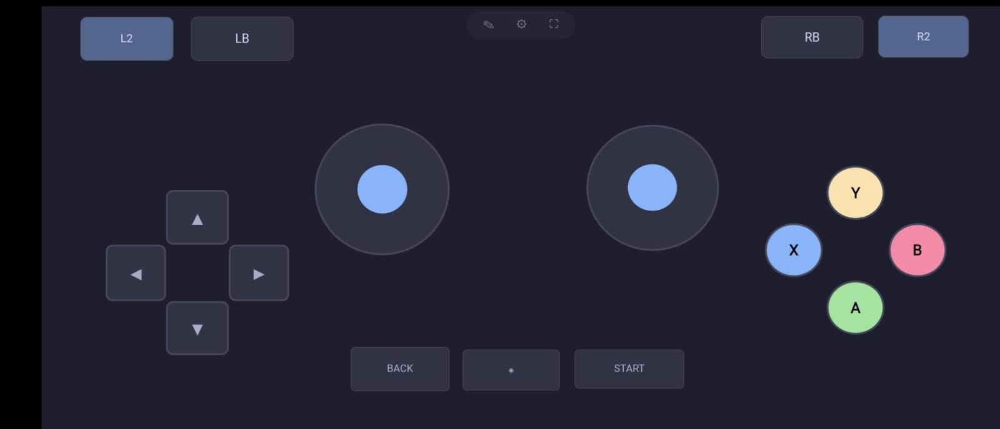

# Virtual Controller

Use your phone as a wireless Xbox 360 controller for PC games.

Touch controls on your phone → PC thinks a real Xbox controller is plugged in. Works with Wine, Steam, emulators — anything that supports a gamepad.



## How to use

```bash
go build -o controller-server .
sudo cp 99-uinput.rules /etc/udev/rules.d/ && sudo udevadm control --reload-rules && sudo udevadm trigger
sudo usermod -aG wheel "$USER"   # log out & back in after this
./controller-server
```

Open `http://<your-pc-ip>:9449` on your phone browser. Connect. Press **▶ Start**. Rotate to landscape.

That's it. The virtual controller appears on your PC, games detect it.

## What you can do

- Tap buttons, pull triggers, move sticks — just like a real controller
- Works with multiplayer games — each phone gets its own controller
- Edit mode (✎): drag controls anywhere, resize them, snap to grid
- Adjust deadzone, trigger feel, and polling speed in ⚙ settings
- Game running won't let your PC sleep

## APIs

| Endpoint | What it does |
|---|---|
| `/api/config` | Read/change settings |
| `/api/layout` | Save/load control positions |
